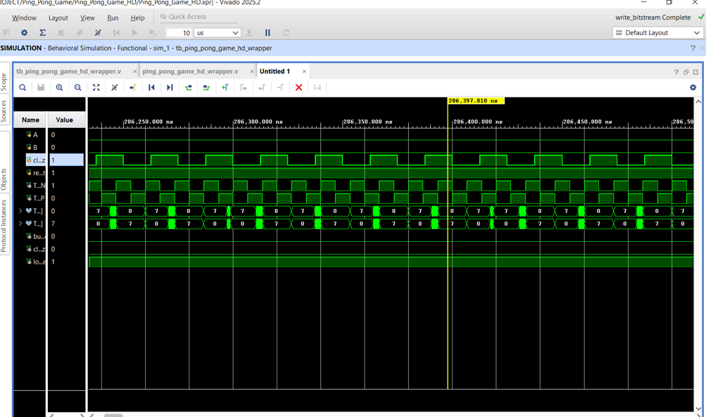

# FPGA Ping Pong Game — Verilog RTL

An FPGA-based Ping Pong game developed as a Semester 2 graduation project in the Semiconductor Chip Design Engineer training program at FPT Jetking.

The project was implemented using Verilog RTL on the **EBAZ4205 FPGA board with an extension board**. It combines game logic, HDMI video output, rotary encoder input, and buzzer-based audio effects.

## Project Overview

The design implements a single-player game in FPGA hardware, combining game logic, HDMI/TMDS video output, rotary encoder input, and buzzer audio effects.

## Hardware and Tools

- **FPGA Board:** EBAZ4205 + extension board
- **HDL:** Verilog
- **Development Tool:** Xilinx Vivado
- **Video Interface:** HDMI/TMDS
- **User Input:** Rotary Encoder
- **Audio Output:** Buzzer
- **Display Resolution:** 1280 × 720 (720p)

## Key Features

- Real-time game logic implemented in FPGA hardware.
- Ball movement, wall and paddle collision handling, and score tracking.
- HDMI video timing and pixel rendering.
- Rotary encoder control for moving the paddle left and right.
- Buzzer background music and gameplay sound effects.
- Modular RTL design using separate Verilog modules.

## My Contributions

This was a team project. My documented contributions included:

- **Video Timing:** Worked on the `video_timing` module and HDMI video timing.
- **Font ROM:** Implemented bitmap patterns for score digits and game-over text in `font_rom`.
- **Audio Logic:** Developed the `game_buzzer_music` module for background music and collision sound effects.
- **Rotary Encoder:** Implemented rotary encoder signal decoding for left/right paddle control.

## Repository Structure

```text
fpga-ping-pong-game/
├── README.md
├── rtl/
│   ├── clk_div.v
│   ├── crazy_frog.v
│   ├── font_rom.v
│   ├── game_buzzer_music.v
│   ├── game_engine.v
│   ├── pixel_renderer.v
│   ├── reset_gen.v
│   ├── rotary_encoder.v
│   ├── video_timing.v
│   └── without_me.v
├── constraints/
│   └── pin_map.xdc
├── simulation/
│   └── tb_ping_pong_game_hd_wrapper.v
├── docs/
│   ├── ping_pong_game_hd.pdf
│   ├── Bao_Cao_Do_An_Ping_Pong_Game_FPGA.docx
│   └── simulation_waveform.png
└── media/
    └── Demo_Video_ping_pong_game.mp4
```

## RTL Module Overview

- `game_engine.v` — game state, ball and paddle behavior, collision handling, and score tracking.
- `pixel_renderer.v` — pixel and color generation for game graphics.
- `font_rom.v` — bitmap patterns for score digits and game-over text.
- `video_timing.v` — video synchronization and pixel timing.
- `rotary_encoder.v` — rotary encoder signal decoding.
- `game_buzzer_music.v` — background music and gameplay sound effects.
- `clk_div.v` — clock division.
- `reset_gen.v` — reset generation and control.

## Project Documentation

- **Project Report (PDF):** [View report](docs/ping_pong_game_hd.pdf)
- **Editable Project Report:** [View DOCX](docs/Bao_Cao_Do_An_Ping_Pong_Game_FPGA.docx)
- **Simulation Testbench:** [View testbench](simulation/tb_ping_pong_game_hd_wrapper.v)
- **Simulation Waveform:** [View waveform](docs/simulation_waveform.png)

Make sure the filenames and capitalization match the files uploaded to this repository.

## Simulation Results

Behavioral simulation was performed in Xilinx Vivado to inspect the design signals and verify the simulation behavior.



## How to Open the Project

1. Open the project in Xilinx Vivado.
2. Add the required Verilog RTL source files.
3. Add `constraints/pin_map.xdc`.
4. Keep the verified pin assignments unchanged unless you intentionally validate a new hardware configuration.
5. Run synthesis and implementation, generate the bitstream, and test the design on the EBAZ4205 board with its extension board.

## Project Status

**Completed and successfully demonstrated** as a Semester 2 graduation project at FPT Jetking.

This repository documents the RTL design, hardware integration, and learning outcomes of the project.
